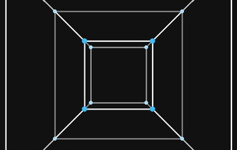
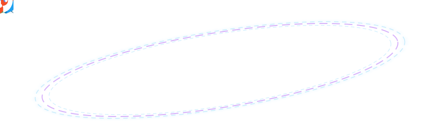
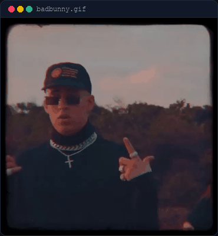

<!-- ═══════════════════════════════════════════════════════════════════ -->
<!-- 1. ENCABEZADO Y TÍTULOS DINÁMICOS                                   -->
<!-- ═══════════════════════════════════════════════════════════════════ -->

  

  

 

---

<!-- ═══════════════════════════════════════════════════════════════════ -->
<!-- 2 & 3. TARJETA DE PERFIL NEOFETCH ASCII Y TERMINAL INTERACTIVA     -->
<!-- ═══════════════════════════════════════════════════════════════════ -->

  

 

---

<!-- ═══════════════════════════════════════════════════════════════════ -->
<!-- 4. ENTORNO DE DESARROLLO (SPECS CARD Y TESERACTO 4D)               -->
<!-- ═══════════════════════════════════════════════════════════════════ -->

<table border="0">
  <tr>
    <td align="center" valign="middle">
      

        

          ESTACIÓN DE TRABAJO
        

        

          ❯ Sistema Operativo: Windows 11 Pro 
          ❯ Entorno Principal: Antigravity IDE &amp; VS Code 
          ❯ Shell Activo: PowerShell / Zsh 
          ❯ Metodología: Scrum &amp; Liderazgo Ágil 
          ❯ Especialidad: Arquitectura Limpia y Modular 
          ❯ Estado Actual: Disponible para Proyectos
        

      

    </td>
    <td align="center" valign="middle">
      

        
      

    </td>
  </tr>
</table>

 

---

<!-- ═══════════════════════════════════════════════════════════════════ -->
<!-- 5 & 6. REDES SOCIALES Y CONTACTO PROFESIONAL                      -->
<!-- ═══════════════════════════════════════════════════════════════════ -->

  

  
  &nbsp;&nbsp;
  
  &nbsp;&nbsp;
  
  &nbsp;&nbsp;
  

 

---

<!-- ═══════════════════════════════════════════════════════════════════ -->
<!-- 7. STACK TECNOLÓGICO: ÓRBITA 3D ANILLO DE SATURNO                 -->
<!-- ═══════════════════════════════════════════════════════════════════ -->

  

  

 

---

<!-- ═══════════════════════════════════════════════════════════════════ -->
<!-- 8 & 9. ESTADÍSTICAS DE GITHUB (RACHA Y LENGUAJES)                 -->
<!-- ═══════════════════════════════════════════════════════════════════ -->

  

  <!-- Layout lado a lado: Terminal Bad Bunny Grande a la izquierda y Racha + Lenguajes a la derecha -->
  <table border="0">
    <tr>
      <td align="center" valign="middle">
        <!-- Terminal Bad Bunny en formato ampliado (370 x 400) -->
        

          

            ●
            ●
            ●
            badbunny.gif
          

          
        

      </td>
      <td align="center" valign="middle">
        <!-- Racha de GitHub -->
        
         
        <!-- Top Lenguajes de Programación con Python -->
        
      </td>
    </tr>
  </table>

 

---

<!-- ═══════════════════════════════════════════════════════════════════ -->
<!-- 10. PACMAN / ACTIVIDAD DE CONTRIBUCIONES                          -->
<!-- ═══════════════════════════════════════════════════════════════════ -->

  

  

 

---

<!-- ═══════════════════════════════════════════════════════════════════ -->
<!-- 11. REPRODUCIENDO EN SPOTIFY EN VIVO                              -->
<!-- ═══════════════════════════════════════════════════════════════════ -->

  

<table border="0">
<tr>
<td align="center" valign="middle">
  
</td>
</tr>
</table>

 
