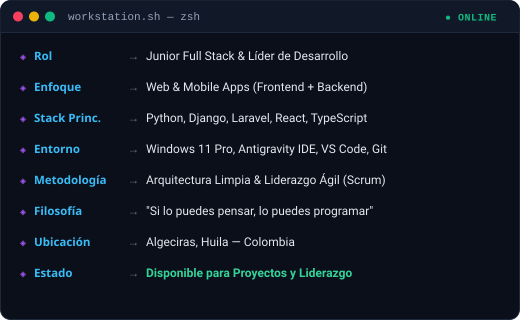

<!-- ═══════════════════════════════════════════════════════════════════ -->
<!-- 1. ENCABEZADO Y TÍTULOS DINÁMICOS                                   -->
<!-- ═══════════════════════════════════════════════════════════════════ -->

  
   
  

---
<!-- ═══════════════════════════════════════════════════════════════════ -->
<!-- 2 & 3. TARJETA DE PERFIL NEOFETCH ASCII Y TERMINAL INTERACTIVA     -->
<!-- ═══════════════════════════════════════════════════════════════════ -->

  

 

---

<!-- ═══════════════════════════════════════════════════════════════════ -->
<!-- 4. ENTORNO DE DESARROLLO (SPECS CARD Y TESERACTO 4D)               -->
<!-- ═══════════════════════════════════════════════════════════════════ -->

<table border="0">
<tr>
<td align="center" valign="middle">

</td>
<td align="center" valign="middle">

</td>
</tr>
</table>

 

---

<!-- ═══════════════════════════════════════════════════════════════════ -->
<!-- 5 & 6. REDES SOCIALES Y CONTACTO PROFESIONAL                      -->
<!-- ═══════════════════════════════════════════════════════════════════ -->

  

  
  &nbsp;&nbsp;
  
  &nbsp;&nbsp;
  

 

---

<!-- ═══════════════════════════════════════════════════════════════════ -->
<!-- 7. STACK TECNOLÓGICO: ÓRBITA 3D ANILLO DE SATURNO                 -->
<!-- ═══════════════════════════════════════════════════════════════════ -->

  

  

 

---

<!-- ═══════════════════════════════════════════════════════════════════ -->
<!-- 8 & 9. ESTADÍSTICAS DE GITHUB (RACHA Y LENGUAJES)                 -->
<!-- ═══════════════════════════════════════════════════════════════════ -->

  

<table border="0">
<tr>
<td align="center" valign="middle">

</td>
<td align="center" valign="middle">

 

</td>
</tr>
</table>

 

---

<!-- ═══════════════════════════════════════════════════════════════════ -->
<!-- 10. PACMAN / ACTIVIDAD DE CONTRIBUCIONES                          -->
<!-- ═══════════════════════════════════════════════════════════════════ -->

  

  

 

---

<!-- ═══════════════════════════════════════════════════════════════════ -->
<!-- 11. REPRODUCIENDO EN SPOTIFY EN VIVO                              -->
<!-- ═══════════════════════════════════════════════════════════════════ -->

  

<table border="0">
<tr>
<td align="center" valign="middle">

</td>
<td align="center" valign="middle">

</td>
</tr>
</table>

 
